# Easy42

[](LICENSE)
[](https://www.wireguard.com/)
[](https://bird.network.cz/)
[](agent/)

**Easy42** is an automated **Linux Kernel WireGuard overlay orchestrator and dynamic routing engine**. It connects private Linux servers, edge gateways, cloud VPS instances, and homelabs into high-performance, self-healing mesh networks, while providing seamless, automated BGP peering with external networks such as [DN42](https://dn42.eu/), NeoNetwork, or private Autonomous Systems.

Easy42 combines an intuitive, visual **Web UI** with a scriptable **CLI**, supporting both **agent-less (SSH/SFTP)** deployments and **agent-powered (`easy42-agent` via WebSockets)** topologies behind NAT.

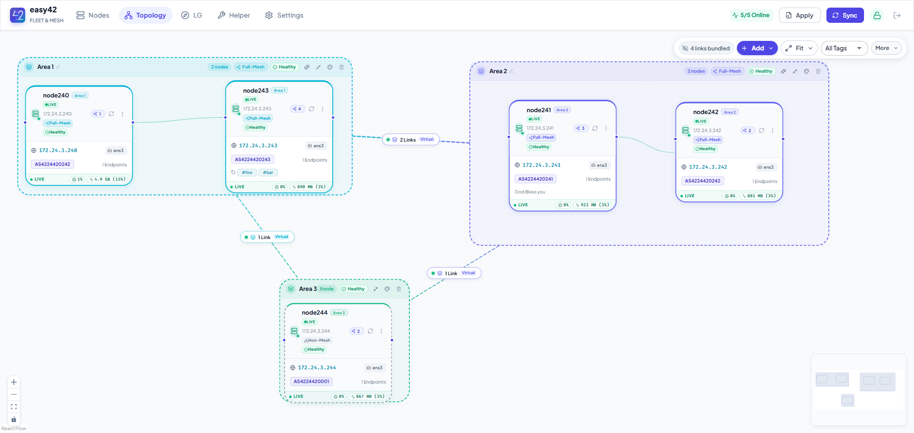

---

- [Easy42](#easy42)
  - [Screenshots](#screenshots)
  - [Why Easy42?](#why-easy42)
  - [Key Features](#key-features)
  - [Quick Start](#quick-start)
    - [1. Prerequisites](#1-prerequisites)
    - [2. Download easy42](#2-download-easy42)
    - [3. Starting the Service](#3-starting-the-service)
    - [4. Basic 3-Step Workflow](#4-basic-3-step-workflow)
  - [Documentation Hub](#documentation-hub)
  - [Target Use Cases](#target-use-cases)
  - [License](#license)

## Screenshots

<details>
<summary>Nodes List & Fleet Overview</summary>

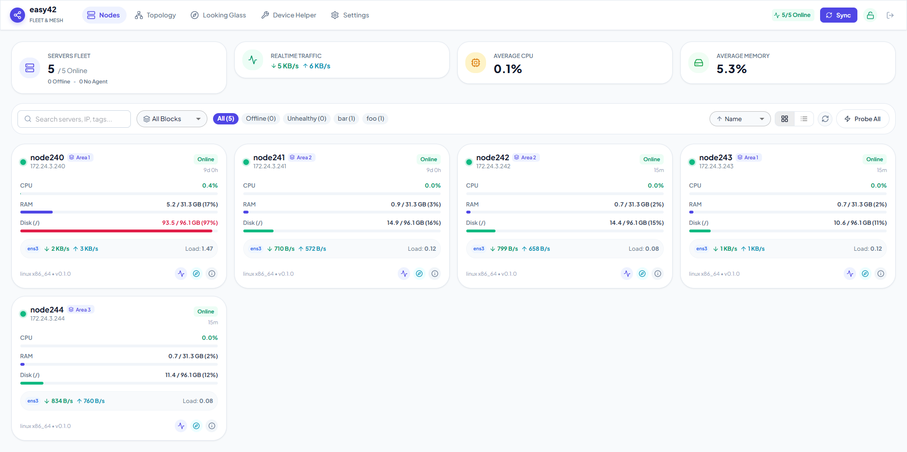

</details>

<details>
<summary>Node Details & Real-Time Telemetry</summary>

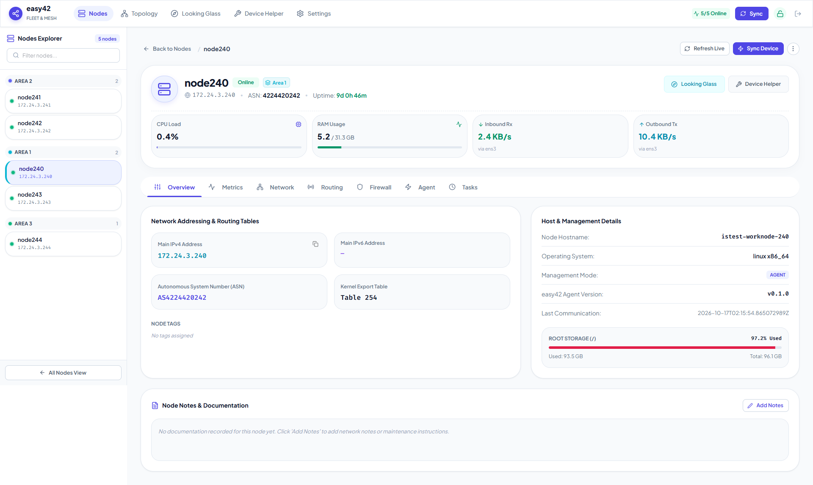

</details>

<details>
<summary>Add Node Dialog</summary>

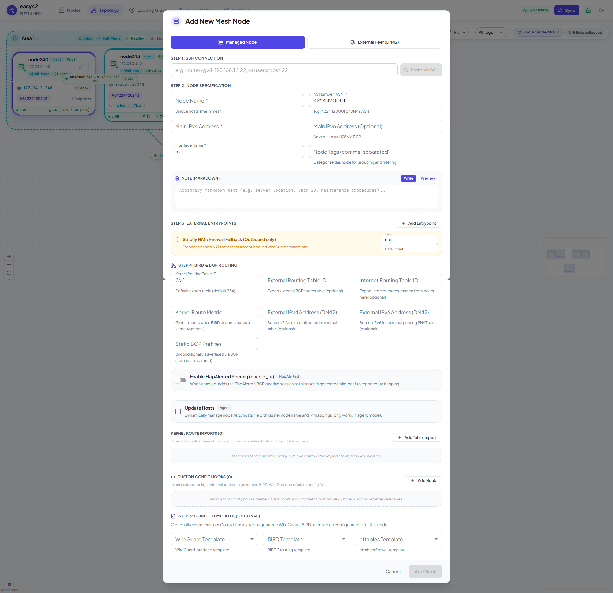

</details>

<details>
<summary>Add Link Dialog</summary>

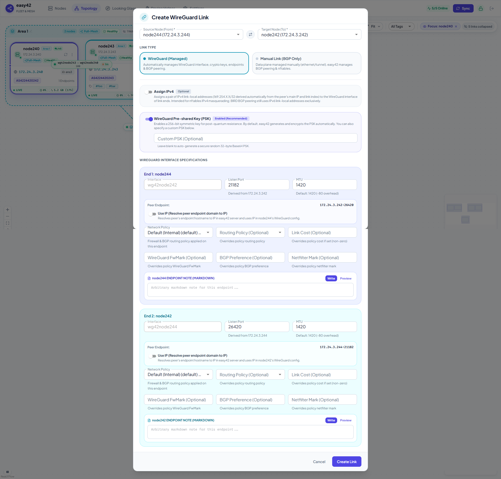

</details>

<details>
<summary>Create Network Policy Dialog</summary>

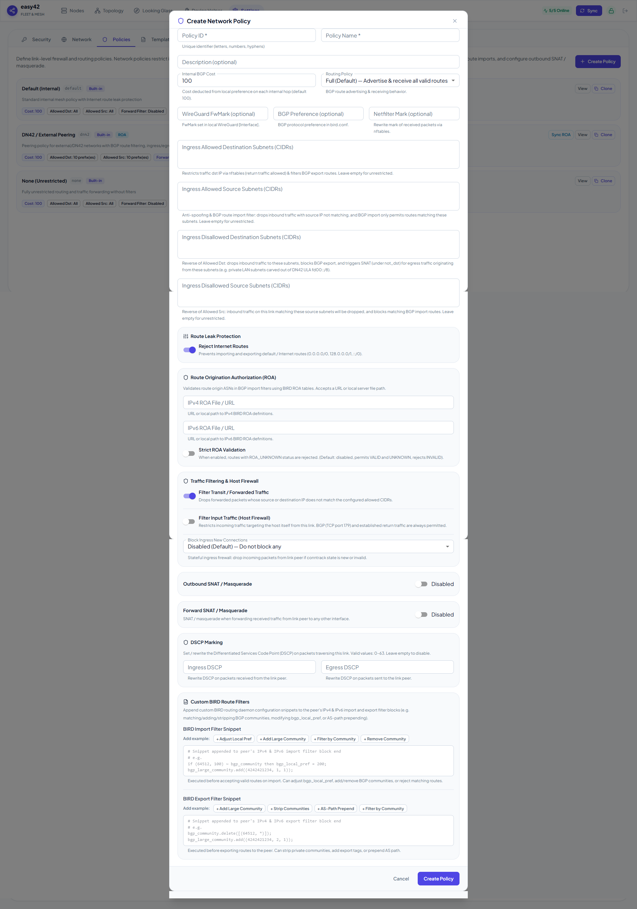

</details>

<details>
<summary>Device Helper (Remote Host Automation)</summary>

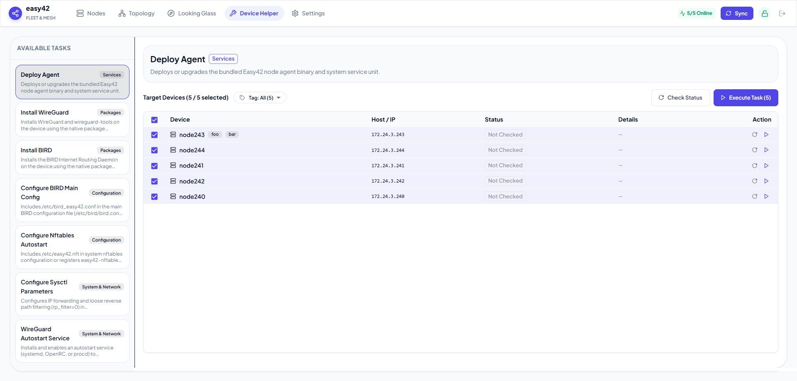

</details>

<details>
<summary>Interactive Looking Glass</summary>

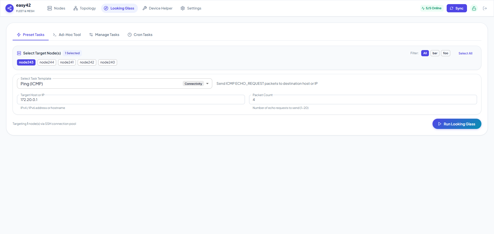

</details>

<details>
<summary>Configuration Diff & Synchronize Dialog</summary>

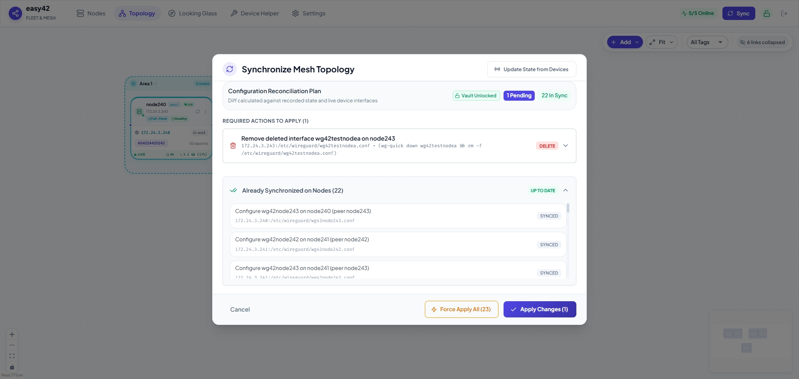

</details>

<details>
<summary>Cluster Settings & Integrations</summary>

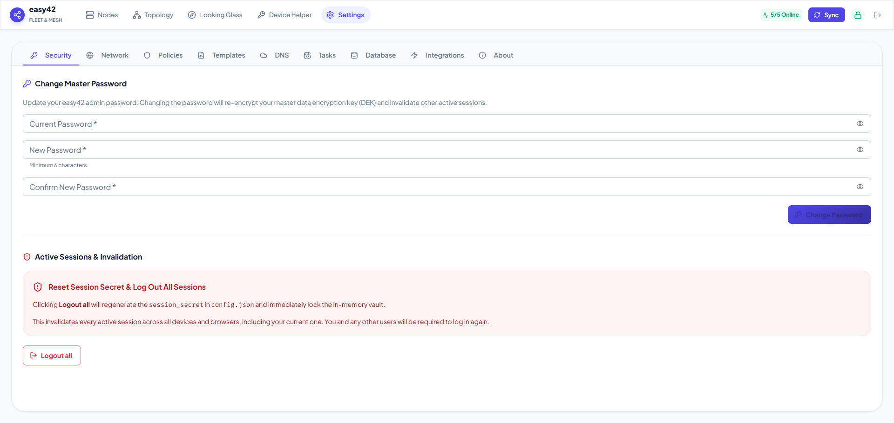

</details>

<details>
<summary>Responsive Mobile View</summary>

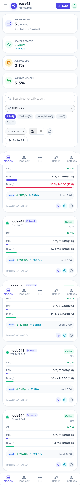

</details>

## Why Easy42?

- **Unified Control Plane**: A single tool to manage `wireguard`, `bird`, `nft` configurations of every node in the cluster from a central place. It is the only tool you need to bootstrap your cluster, make it work and ensure observability.
- **Pure Linux Kernel Line Rate**: Unlike userspace overlay networks (Tailscale, ZeroTier) that incur userspace context-switch overhead, Easy42 uses native Linux kernel WireGuard interfaces (`wg42*`).
- **Standard Dynamic Routing**: Powered by **BIRD 2** running Multiprotocol BGP over IPv6 link-local addresses (RFC 8950 / RFC 5549) with sub-second **BFD** failover. No proprietary routing protocols or vendor lock-in.
- **Zero Tunnel IPAM Headaches**: Overlay tunnels use deterministic IPv6 link-local (`fe80::/64`) and optional deterministic IPv4 link-local (`169.254.X.X/32`) addressing, saving your routable IP prefixes for actual workloads.
- **Zero-Dependency Host Provisioning**: Built-in **Device Helper** verifies prerequisites, installs WireGuard/BIRD, tunes sysctl parameters (forwarding, rp_filter), and configures startup daemons across heterogeneous Linux distributions (Debian, Ubuntu, Alpine, Arch, OpenWrt) directly from the Web UI or API—no Ansible needed.
- **Agent-Less or Agent-Powered**: Manage nodes agent-lessly over standard SSH, or deploy the static Rust agent (`easy42-agent`) for nodes behind firewalls, symmetric NAT, or without public IPs.

---

## Key Features

- **Automated Dynamic Routing**: BGP Confederations (RFC 5065), iBGP full-mesh elimination, sub-second BFD convergence, multi-table kernel FIB synchronization, and automatic Route Origin Authorization (ROA) validation.
- **Stateful Security & nftables**: Automatic `/etc/easy42.nft` ruleset generation featuring path-MTU MSS clamping, cross-tunnel transit SNAT, and incoming connection filtering (`block_ingress_new` with port whitelisting).
- **Device Helper & Remote Host Automation**: Integrated host preparation engine to install WireGuard/BIRD, configure `/etc/sysctl.d/99-easy42.conf`, inject BIRD/nftables includes, configure interface autostart on boot, and deploy `easy42-agent` binaries with real-time web terminal output.
- **Post-Quantum WireGuard PSK Support**: Add optional Preshared Keys (PSK) to any WireGuard link for defense-in-depth against quantum cryptanalysis.
- **Agent Sync Hooks**: Execute pre-sync and post-sync shell scripts on edge nodes with rich execution context and safety abort semantics.
- **Real-Time Telemetry & Traffic History**: Live CPU, memory, load average, disk usage, interface throughput (Rx/Tx B/s), and WireGuard handshake tracking.
- **Prometheus Metrics Integration**: Built-in `/metrics` endpoint exposing cluster-wide telemetry, agent statuses, node resource usage, and tunnel traffic counters.
- **Automatic `/etc/hosts` Management**: Keep node hostnames and overlay IPs automatically synchronized across all cluster nodes.
- **Interactive Looking Glass**: Built-in visual diagnostic suite supporting ICMP Ping, TCP Ping, Traceroute, MTR (with automatic node hop mapping), and live BIRD route inspection.
- **Cloudflare DNS Automation**: Automatically synchronize node overlay IPv4/IPv6 hostnames and wildcards directly to Cloudflare DNS zones.
- **Encrypted State Store**: Private keys and sensitive credentials are encrypted with XAES-256-GCM using an Argon2id-derived key and protected in volatile memory with `memguard`.

---

## Quick Start

### 1. Prerequisites

- **Controller**: Linux amd64 or arm64. The Easy42 is a pure-Go program so it should also work on other systems but we only provide pre-built binaries for Linux at this time.
- **Managed Nodes**: Modern Linux distribution (Debian, Ubuntu, CentOS/RHEL/Rocky, Alpine, Arch, OpenWrt) with root / sudo access.
  - Note for `OpenWrt`: `easy42` requires `wg` & `wg-quick` installed on managed node to work. You can install `wireguard` normally on OpenWrt but the native `wg-quick` is not available in OpenWrt at this time. However you can easily install a compatible third-party wg-quick implementation on OpenWrt such as [wg-quick-op](https://github.com/dn-11/wg-quick-op), just download the binary and put it to `/usr/bin/wg-quick` and it's done.
- **SSH Credentials (for SSH-Managed Nodes & Device Helper)**: Easy42 directly and exclusively uses the current OS user's OpenSSH files (`~/.ssh/id_ed25519` for authentication and `~/.ssh/known_hosts` for strict server host key verification). Ensure your public key (`id_ed25519.pub`) is authorized on target nodes and their host keys exist in `~/.ssh/known_hosts`. Standard `~/.ssh/config` aliases, custom ports, and identities are also respected.

### 2. Download easy42

Download easy42 binary from [GitHub Releases](https://github.com/sagan/easy42/releases).

Put the downloaded `easy42` binary file to any location.

### 3. Starting the Service

```bash
# Launch the controller daemon. Listen 127.0.0.1:4242 by default.
# All data are stored in ~/.config/easy42 dir by default.
./easy42 serve
```

On first launch, Easy42 initializes the configuration and generates a secure admin password:

```
=== easy42 First-Time Setup ===
=======================================================
Generated Web UI Admin Password:  aB3dE5gH7jK9mN1pQ3rS5t
Save this password! You will need it to login to the Web UI.
=======================================================
```

Open `http://127.0.0.1:4242` in your browser and sign in with the generated password.

You can write a standard systemd unit file to run easy42 as a service. Example `easy42.service`:

```
[Unit]
Description=easy42

[Service]
User=root
Type=simple
ExecStart=/usr/bin/easy42 serve
Restart=always

[Install]
WantedBy=multi-user.target
```

Put it in `/etc/systemd/system/easy42.service` and run `systemctl enable --now easy42` to enable & start it. Check service status & logs via `systemctl status easy42` and `journalctl -u easy42`.

In production environment you need to run easy42 behind a TLS enabled reverse proxy such as `nginx`, `traefik`, `caddy` or any other your choosed one.

### 4. Basic 3-Step Workflow

1. **Add Nodes**: In the Web UI or via `easy42 node add`, specify the node name, management mode (SSH or Agent), and overlay IP.
   > **Tip**: Use the built-in **[Device Helper](docs/device-helper.md)** (`/helper`) to verify node prerequisites, install WireGuard/BIRD, configure sysctl forwarding/rp_filter, or deploy `easy42-agent` on your hosts with a single click.
2. **Connect Links**: Drag a link between two nodes on the visual canvas (or run `easy42 link add node-a node-b`).
3. **Synchronize**: Review the configuration diff and click **Sync** (or run `easy42 sync`). Easy42 provisions WireGuard tunnels, configures BIRD 2, and brings up the mesh.

---

## Documentation Hub

Detailed technical guides and architectural deep dives have been separated into dedicated documentation files:

| Document                                                     | Description                                                                                                                                                   |
| :----------------------------------------------------------- | :------------------------------------------------------------------------------------------------------------------------------------------------------------ |
| **[Architecture & Data Plane](docs/architecture.md)**        | Deep dive into link-local addressing, WireGuard interface design, entrypoint selection, and the cryptographic security model.                                 |
| **[Dynamic Routing with BIRD 2](docs/routing.md)**           | BGP confederations, sub-second BFD failover, loopback route origination, network policies, link costs, and ROA validation.                                    |
| **[nftables Firewall & NAT](docs/firewall.md)**              | Stateful packet filtering, TCP MSS clamping, transit SNAT, and policy-based ingress protection.                                                               |
| **[Node Agent (`easy42-agent`) & Hooks](docs/agent.md)**     | Rust agent architecture, real-time telemetry streaming, edge cron probes, and lifecycle sync hooks (`pre_sync` / `post_sync`).                                |
| **[Device Helper & Node Automation](docs/device-helper.md)** | Remote host provisioning, embedded bootstrap tasks, multi-distro package and sysctl configuration, tag-based fleet execution, and REST API.                   |
| **[Integrations & Extended Features](docs/integrations.md)** | Prometheus metrics exporter (`/metrics`), sample Grafana dashboards, automatic `/etc/hosts` sync, WireGuard PSK, database data retention, and Cloudflare DNS. |
| **[Configuration Specification](docs/configuration.md)**     | Complete reference schema and annotated example for `config.json`.                                                                                            |
| **[CLI Reference](docs/cli.md)**                             | Complete command-line manual for `easy42 serve`, `node`, `link`, `status`, and `sync`.                                                                        |
| **[Operations & Troubleshooting](docs/troubleshooting.md)**  | Interface verification, BIRD diagnostics, live health checks, and common gotchas.                                                                             |

---

## Target Use Cases

- **DN42 & Public AS Peering**: Manage internal iBGP/confederation meshes across global PoPs, automate external eBGP peerings with ROA validation and route-leak protection.
- **Private Server Mesh & Homelab**: Seamlessly interconnect cloud VPS instances, home lab virtualization clusters, and bare-metal servers without public port forwarding.
- **Multi-Homed & Asymmetric Routing**: Leverage BGP path manipulation (link costs and negative costs) for active-passive or latency-steered transit failover.
- **Edge Devices Behind NAT**: Connect edge routers and home servers running `easy42-agent` without requiring inbound public IP addresses.

---

## License

Easy42 is open-source software licensed under the **[MIT License](LICENSE)**.
