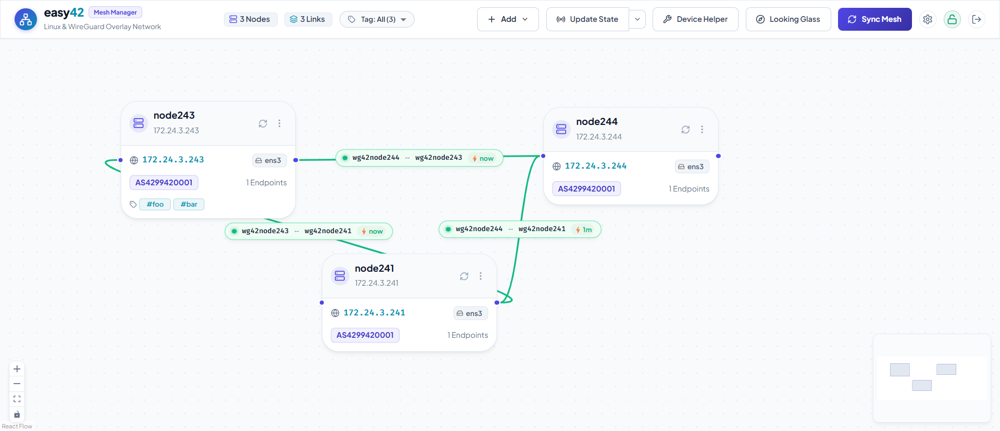

## Easy42

**Easy42** is a hybrid **agent-less (SSH/SFTP)** and **agent-powered (`easy42-agent` via WebSocket)** WireGuard overlay network orchestrator and dynamic routing automation engine. It is designed to interconnect private Linux servers, edge routers, and homelabs into high-performance, self-healing mesh networks, while providing seamless, automated BGP peering with external networks such as [DN42](https://dn42.eu/), NeoNetwork, or private Autonomous Systems. Easy42 includes both a rich, interactive Web UI and a scriptable CLI interface.



- [Easy42](#easy42)
- [Overview](#overview)
- [Key Features](#key-features)
- [Target Use Cases](#target-use-cases)
  - [1. Private Server Mesh \& Homelab Overlay](#1-private-server-mesh--homelab-overlay)
  - [2. DN42 \& External Autonomous System Peering](#2-dn42--external-autonomous-system-peering)
  - [3. Asymmetric \& Multi-Homed Routing](#3-asymmetric--multi-homed-routing)
  - [4. NAT Traversal \& Hybrid Edge Deployments](#4-nat-traversal--hybrid-edge-deployments)
- [System Architecture](#system-architecture)
- [How It Works Under the Hood](#how-it-works-under-the-hood)
  - [1. Data Plane \& Dual-Stack Link-Local Addressing](#1-data-plane--dual-stack-link-local-addressing)
    - [Deterministic IPv6 Link-Local (`fe80::/64`)](#deterministic-ipv6-link-local-fe8064)
    - [Deterministic IPv4 Link-Local (`169.254.X.X/32`, RFC 3927)](#deterministic-ipv4-link-local-169254xx32-rfc-3927)
    - [Multiprotocol BGP over IPv6 Link-Local (RFC 8950 / RFC 5549)](#multiprotocol-bgp-over-ipv6-link-local-rfc-8950--rfc-5549)
    - [Safe Interface Naming (`IFNAMSIZ` 15-Character Compliance)](#safe-interface-naming-ifnamsiz-15-character-compliance)
  - [2. WireGuard \& Manual Links](#2-wireguard--manual-links)
    - [WireGuard Parameter Rationale](#wireguard-parameter-rationale)
    - [Manual Links (Non-WireGuard Tunnels \& Existing Interfaces)](#manual-links-non-wireguard-tunnels--existing-interfaces)
  - [3. Dynamic Routing with BIRD 2](#3-dynamic-routing-with-bird-2)
    - [BGP Confederations \& Autonomous Systems](#bgp-confederations--autonomous-systems)
    - [Sub-Second Fast Convergence with BFD](#sub-second-fast-convergence-with-bfd)
    - [Route Origination \& Loopback Announcement](#route-origination--loopback-announcement)
    - [Multi-Table Kernel FIB Synchronization \& Metrics](#multi-table-kernel-fib-synchronization--metrics)
    - [Dynamic Kernel Route Import \& Static Route Broadcasting](#dynamic-kernel-route-import--static-route-broadcasting)
    - [FlapAlerted BGP Peering \& Alerting Integration](#flapalerted-bgp-peering--alerting-integration)
    - [Route Leak Protection](#route-leak-protection)
  - [4. nftables Firewall, NAT, MSS Clamping \& Security](#4-nftables-firewall-nat-mss-clamping--security)
    - [Detailed Rule Explanations](#detailed-rule-explanations)
  - [5. Route Origin Authorization (ROA)](#5-route-origin-authorization-roa)
  - [6. Node Agent (`easy42-agent`) \& Live Telemetry](#6-node-agent-easy42-agent--live-telemetry)
  - [7. Cloudflare DNS Automation](#7-cloudflare-dns-automation)
  - [8. Config Templates Engine \& Hooks](#8-config-templates-engine--hooks)
- [Network Policies](#network-policies)
  - [Link Costs, Negative Costs \& Latency Steering](#link-costs-negative-costs--latency-steering)
  - [Routing Policy Modes](#routing-policy-modes)
- [Installation \& Quick Start](#installation--quick-start)
  - [Prerequisites](#prerequisites)
  - [Building from Source](#building-from-source)
  - [Starting the Service](#starting-the-service)
  - [Device Config Helper (Bootstrap Tasks)](#device-config-helper-bootstrap-tasks)
- [CLI Reference](#cli-reference)
  - [Global Flags](#global-flags)
  - [1. Server Daemon](#1-server-daemon)
  - [2. Node Management](#2-node-management)
  - [3. WireGuard \& Manual Link Management](#3-wireguard--manual-link-management)
  - [4. Status Inspection \& Connectivity Probes](#4-status-inspection--connectivity-probes)
  - [5. Topology Synchronization](#5-topology-synchronization)
- [Configuration Specification](#configuration-specification)
  - [Entrypoint Selection Algorithm](#entrypoint-selection-algorithm)
- [Security \& Encryption Architecture](#security--encryption-architecture)
- [Operational \& Troubleshooting Guide](#operational--troubleshooting-guide)
  - [Verifying WireGuard Interfaces](#verifying-wireguard-interfaces)
  - [Inspecting BIRD 2 Dynamic Routing](#inspecting-bird-2-dynamic-routing)
  - [Debugging nftables Rules](#debugging-nftables-rules)
  - [Managing and Troubleshooting the Node Agent](#managing-and-troubleshooting-the-node-agent)
  - [Common Gotchas \& Fixes](#common-gotchas--fixes)
- [License](#license)

---

## Overview

Unlike userspace overlay tools (such as Tailscale or ZeroTier) that route packets through userspace TUN adapters, Easy42 relies exclusively on the **Linux kernel WireGuard data plane**, paired with **BIRD 2** for dynamic routing (MP-BGP over IPv6 link-local with BFD) and **nftables** for stateful firewalling, MSS clamping, and policy-based SNAT.

Easy42 supports two complementary management modes:

1. **Agent-Less Mode**: Manages remote nodes over standard SSH/SFTP with zero background software required on the target hosts.
2. **Agent Mode (`easy42-agent`)**: A lightweight, high-performance Rust daemon running on remote nodes that connects back to the controller over secure WebSockets. This unlocks real-time server telemetry, automated cron health probes, and management of nodes located strictly behind NAT/firewalls without open inbound SSH ports.

---

## Key Features

- **Pure Linux Kernel Performance**: Zero userspace encapsulation overhead. Point-to-point WireGuard kernel interfaces (`wg42*`) handle all tunnel traffic at wire speed.
- **Dual Orchestration Modes (Agent-Less & Agent-Powered)**: Deploy configurations over SSH/SFTP or manage nodes behind NAT via the embedded, lightweight Rust agent (`easy42-agent`).
- **Multiprotocol BGP over IPv6 Link-Local (RFC 8950 / RFC 5549)**: Uses single-session BGP peering over deterministic IPv6 link-local addresses (`fe80::/64`) with Extended Next Hop to exchange both IPv4 and IPv6 routes, eliminating tunnel IPAM complexity.
- **Deterministic IPv4 Link-Local (`169.254.X.X/32`, RFC 3927)**: Optional deterministic assignment of IPv4 link-local pairs for peering appliances or software stacks requiring IPv4 next hops.
- **Sub-Second Failover with BFD**: Native BIRD 2 `protocol bfd` integration provides sub-second link failure detection and instant route recalculation.
- **Automated BGP Confederations & iBGP/eBGP**: Supports single ASN topologies or private BGP confederations (AS 4224420000–4224429999) presenting a unified public ASN (e.g., DN42 ASN) to external peers.
- **Stateful Security & nftables Generation**: Automated compilation of `/etc/easy42.nft` featuring state tracking, path-MTU MSS clamping, cross-tunnel SNAT, connection blocking (`block_ingress_new` with whitelist exceptions), and granular port filtering.
- **Live Telemetry & Server Monitoring**: Continuous streaming and historical charts of CPU load, memory utilization, load averages, partition disk usage, network interface throughput, and real-time WireGuard handshake/byte counters.
- **Scheduled Cron Health Probes**: Edge-executed ICMP and TCP ping cron tasks scheduled across nodes with SQLite persistence for loss, latency, and jitter tracking.
- **Interactive Looking Glass**: Built-in visual diagnostic suite supporting ICMP Ping, TCP Ping, Traceroute, MTR (with automatic node name hop mapping), `birdc show route`, and `birdc show protocols`.
- **Cloudflare DNS Automation**: Dynamic synchronization of node overlay IPv4/IPv6 addresses (`<node>.<domain>`, `*.<node>.<domain>`, `<node>6.<domain>`) directly to Cloudflare DNS zones.
- **FlapAlerted Integration**: Automated BGP peering with [FlapAlerted](https://github.com/Kioubit/FlapAlerted) instances for real-time route flap detection and alert dashboard linking.
- **Config Templates & Hooks Engine**: Fully customizable Go text templates for WireGuard, BIRD 2, and nftables, accompanied by per-node hook injection points (`bird`, `bird.pre`, `wg.interface`, `wg.peer`, `wg.post`, `nft.table`, `nft.pre`).
- **Automated ROA Validation**: Built-in ROA caching engine that fetches remote table definitions (e.g., Burble DN42 ROA) and filters illegitimate route announcements.
- **Visual Topology & Block Canvas**: React topology canvas with drag-and-drop link creation, visual block groupings (regions, datacenters), node search/focus, and edge cost displays.
- **Cryptographic Security**: Node private keys and sensitive credentials are encrypted with XAES-256-GCM using an Argon2id-derived key and protected in volatile memory with `memguard`.

---

## Target Use Cases

### 1. Private Server Mesh & Homelab Overlay

Connect cloud VPS instances, on-premise virtualization hosts, bare-metal servers, and edge gateways into a flat, routable overlay network without port-forwarding headaches or proprietary centralized coordinators.

### 2. DN42 & External Autonomous System Peering

Manage an entire DN42 Autonomous System from a single dashboard:

- Create internal iBGP/confederation meshes between your globally distributed points of presence (PoPs).
- Provision WireGuard or manual tunnel links to external peer ASNs.
- Apply strict route-leak prevention (`reject` for default and global internet routes) and automated ROA validation.
- Route external traffic to designated egress gateways or source-NAT across transit links.
- Monitor route stability via integrated FlapAlerted BGP sessions.

### 3. Asymmetric & Multi-Homed Routing

Use BGP path attributes (e.g., `bgp_local_pref` manipulation based on positive or negative link costs) to build multi-homed topologies with deterministic failover and optimal path selection.

### 4. NAT Traversal & Hybrid Edge Deployments

Manage edge nodes behind NAT (such as home servers or OpenWrt routers) that cannot accept inbound SSH connections. By running `easy42-agent`, edge devices establish an outbound WebSocket connection to the controller, enabling remote configuration synchronization, metrics reporting, and automated diagnostic execution.

---

## System Architecture

```
 ┌─────────────────────────────────────────────────────────────────────────────┐
 │                              easy42 Controller                              │
 │                                                                             │
 │   ┌──────────────────────┐      ┌───────────────────────┐                   │
 │   │  Web UI (React/Vite) │      │      CLI (Cobra)      │                   │
 │   └──────────┬───────────┘      └───────────┬───────────┘                   │
 │              │                              │                               │
 │              ▼                              ▼                               │
 │   ┌─────────────────────────────────────────────────────────────────────┐   │
 │   │                           Engine & State                            │   │
 │   │      - Node & Link Topology Graph       - WebSocket Agent Hub       │   │
 │   │      - Network Policies & Routing       - SQLite Metrics & Cron     │   │
 │   │      - Cloudflare DNS Sync Engine       - ROA Cache Manager         │   │
 │   │      - Visual Blocks & Layouts          - Encrypted State Store     │   │
 │   └──────────────────────────────────┬──────────────────────────────────┘   │
 │                                      │                                      │
 │                                      ▼                                      │
 │   ┌─────────────────────────────────────────────────────────────────────┐   │
 │   │                    Core Compiler & Templates                        │   │
 │   │      - WireGuard Configs (wg42*.conf)                               │   │
 │   │      - BIRD 2 Dynamic Routing (/etc/bird_easy42.conf)               │   │
 │   │      - nftables Ruleset (/etc/easy42.nft)                           │   │
 │   │      - Config Hooks & Custom Template Overrides                     │   │
 │   └──────────────────────────────────┬──────────────────────────────────┘   │
 └──────────────────────┬───────────────┴───────────────┬──────────────────────┘
                        │                               │
             SSH / SFTP │ (Agent-Less)       WebSocket  │ (Agent Mode)
                        │                     (TLS/WSS) │
                        ▼                               ▼
       ┌─────────────────────────────┐   ┌─────────────────────────────┐
       │     Remote Node A (SSH)     │   │    Remote Node B (Agent)    │
       │  ┌───────────────────────┐  │   │  ┌───────────────────────┐  │
       │  │ Linux Kernel WireGuard│  │   │  │   easy42-agent (Rust) │  │
       │  │ /etc/wireguard/wg42B  │  │   │  │   Telemetry & Cron    │  │
       │  └───────────────────────┘  │   │  └───────────┬───────────┘  │
       │  ┌───────────────────────┐  │   │  ┌───────────▼───────────┐  │
       │  │ BIRD 2 (MP-BGP + BFD) │  │   │  │ Linux Kernel WireGuard│  │
       │  └───────────────────────┘  │   │  │ /etc/wireguard/wg42A  │  │
       │  ┌───────────────────────┐  │   │  └───────────────────────┘  │
       │  │ nftables (easy42 tbl) │  │   │  ┌───────────────────────┐  │
       │  └───────────────────────┘  │   │  │ BIRD 2 (MP-BGP + BFD) │  │
       └──────────────┬──────────────┘   │  └───────────────────────┘  │
                      │                  │  ┌───────────────────────┐  │
                      │   P2P WireGuard  │  │ nftables (easy42 tbl) │  │
                      └────── Tunnel ────┴──┴───────────────────────┘  │
                         (IPv6 Link-Local / IPv4 Link-Local)
```

---

## How It Works Under the Hood

Easy42 turns complex Linux routing and firewall primitives into a coherent, declarative mesh. Below is a deep dive into the configurations deployed on every managed node.

---

### 1. Data Plane & Dual-Stack Link-Local Addressing

Every link created between two nodes is a dedicated **point-to-point WireGuard interface** named `wg42<peer>` for internal mesh peers or `wg42-<peer>` for external unmanaged peers.

#### Deterministic IPv6 Link-Local (`fe80::/64`)

Instead of carving up subnets for tunnel interconnects, Easy42 assigns an RFC 4291 compliant IPv6 link-local address to the tunnel interface, derived deterministically from the node's main IPv4 address:

$$\text{IPv4: } 192.168.100.10 \implies \text{IPv6 Link-Local: } \texttt{fe80::c0a8:640a/64}$$

Both ends of the link use their respective link-local addresses. Because link-local traffic is scoped strictly to the interface, the same link-local subnet can exist across multiple interfaces without collision.

#### Deterministic IPv4 Link-Local (`169.254.X.X/32`, RFC 3927)

For integration with third-party software or routing appliances that do not support RFC 8950 Extended Next Hop IPv4 over IPv6, Easy42 can optionally assign a deterministic pair of IPv4 link-local addresses (`169.254.X.X/32`) to the WireGuard interface:

- The IP addresses are derived by hashing the sorted pair of node main IPs, producing a deterministic consecutive `/30` address pair (`4*k + 1` and `4*k + 2`).
- Both endpoints receive dedicated IPv4 link-local addresses, enabling native IPv4 next-hop peering over the tunnel.

#### Multiprotocol BGP over IPv6 Link-Local (RFC 8950 / RFC 5549)

BIRD establishes a single BGP peering session over the IPv6 link-local address bound to the interface (`neighbor fe80::... % 'wg42peer'`). By enabling **Extended Next Hop**, BIRD transmits both IPv4 and IPv6 routing tables over this single session:

```bird
protocol bgp 'easy42_peer_nodeB' from easy42_peer {
    interface "wg42nodeB";
    local fe80::c0a8:640a as SELF_AS;
    neighbor fe80::c0a8:640b % 'wg42nodeB' as 4224420002;
}
```

This eliminates dual-stack tunnel configuration and separate IPv4 BGP sessions.

#### Safe Interface Naming (`IFNAMSIZ` 15-Character Compliance)

Linux network interface names are restricted to 15 characters plus a null terminator (`IFNAMSIZ = 16`). Easy42 enforces this transparently:

- Node names can be arbitrarily long and descriptive (e.g. `frankfurt-edge-router-01`).
- The interface compiler sanitizes and truncates interface names to fit the 15-character limit (`wg42<peer>` truncated to 11 chars, `wg42-<peer>` truncated to 10 chars), trimming trailing hyphens and appending disambiguating suffixes when needed.

---

### 2. WireGuard & Manual Links

For each WireGuard link, Easy42 compiles `/etc/wireguard/wg42<peer>.conf`:

```ini
# Auto-generated by easy42. Do not edit manually.
[Interface]
Address = fe80::c0a8:640a/64, 169.254.120.1/32
ListenPort = 24192
PrivateKey = <unencrypted_node_private_key>
MTU = 1420
PostUp = sysctl -w net.ipv4.conf.%i.rp_filter=0
Table = off

[Peer]
PublicKey = 0Yx+7eQ6gIqXy...=
AllowedIPs = fe80::c0a8:640b/128, 169.254.120.2/32, 0.0.0.0/0, ::/0
Endpoint = 198.51.100.2:25831
PersistentKeepalive = 25
```

#### WireGuard Parameter Rationale

- `Table = off`: **Crucial.** Prevents `wg-quick` from inserting default routes (`0.0.0.0/0`) into the kernel routing table and hijacking internet connectivity. Routing decisions are handled strictly by BIRD.
- `AllowedIPs = <peer_link_locals>, 0.0.0.0/0, ::/0`: In WireGuard, `AllowedIPs` acts as a cryptokey-routing filter. To allow the interface to forward transit packets for any network prefix advertised by BGP, `AllowedIPs` must accept wildcard traffic (`0.0.0.0/0` and `::/0`).
- `ListenPort = 2XXXX`: Calculated deterministically using a 32-bit FNV-1a hash of the peer's IP (`20000 + hash(peer_ip) % 10000`). This avoids port collisions while maintaining stable port assignments across restarts.
- `PostUp = sysctl -w net.ipv4.conf.%i.rp_filter=0`: Overcomes strict Reverse Path Filtering in Linux. In multi-path mesh networks, return packets frequently enter via a different interface than outbound traffic (asymmetric routing). Without `rp_filter=0`, the Linux kernel silently drops valid transit packets.
- `PersistentKeepalive = 25`: Keeps stateful firewall entries and NAT mappings alive on intermediate routers. Automatically enabled if the peer specifies an endpoint.

#### Manual Links (Non-WireGuard Tunnels & Existing Interfaces)

In addition to WireGuard, Easy42 supports **Manual Links** for integrating pre-existing interfaces into the dynamic routing mesh (such as GRE, SIT, IPIP, VXLAN, physical links, or existing tunnel software):

- Manual links bypass WireGuard interface generation and configure BIRD 2 BGP peering directly over the specified interface and neighbor addresses.
- Policies, link costs, BFD, and firewall rules apply seamlessly to manual links.

---

### 3. Dynamic Routing with BIRD 2

Easy42 compiles `/etc/bird_easy42.conf` and includes it in `/etc/bird/bird.conf` via `include "/etc/bird_easy42.conf";`.

#### BGP Confederations & Autonomous Systems

Easy42 supports two BGP architectures:

1. **Flat Private ASN / iBGP Mesh**: All nodes share the same ASN or use private AS numbers.
2. **BGP Confederation (RFC 5065)**: Each internal node is assigned a unique private ASN within `4224420000`–`4224429999`, grouped under a single parent Confederation AS (e.g. your public DN42 ASN `424242xxxx`):
   ```bird
   confederation CONFED_AS;
   confederation member yes;  # Internal peers
   ```
   To external peers (e.g., outside DN42 peerings):
   ```bird
   confederation CONFED_AS;
   confederation member no;   # External eBGP peers
   ```
   External peers see your entire network originating from your public ASN, hiding internal topology while eliminating iBGP full-mesh requirements.

#### Sub-Second Fast Convergence with BFD

Easy42 automatically injects a BIRD 2 BFD protocol block:

```bird
protocol bfd {
    interface "*" {
        min rx interval 2000ms;
        min tx interval 2000ms;
        multiplier 5;
    };
    multihop {
        min rx interval 2000ms;
        min tx interval 2000ms;
        multiplier 5;
    };
}
```

Internal peer protocols enable `bfd yes;`, ensuring instant route withdrawal when an overlay path degrades or drops.

#### Route Origination & Loopback Announcement

Each node has a primary stable IP (e.g., `192.168.100.1` on `lo`). To originate this route into BGP without creating a routing loop on the local host:

```bird
protocol static static_self {
    ipv4;
    route 192.168.100.1/32 reject;
}
```

In BIRD, a `reject` route is purely local to the routing daemon; it injects the `/32` prefix into BIRD's routing table (`master4`) for export to peers, while the local kernel routes packets destined for `192.168.100.1` to the local loopback interface.

#### Multi-Table Kernel FIB Synchronization & Metrics

Learned BGP routes are exported to the Linux kernel FIB:

- **Main Routing Table** (`table 254` by default, or user-configured):
  ```bird
  protocol kernel kernel_v4 {
      metric 100;
      ipv4 {
          export filter {
              krt_prefsrc = SELF_IP;
              if source ~ [ RTS_BGP ] then accept;
              reject;
          };
          import none;
      };
      kernel table TABLE;
  }
  ```
  Setting `krt_prefsrc = SELF_IP` ensures local applications use the overlay IP when originating mesh traffic.
- **External Routing Table (`external_table`)**: Directs external routes (marked with BGP Large Community `(CONFED_AS, 1, 1)`) into an isolated routing table for Policy-Based Routing (PBR).
- **Internet Routing Table (`internet_table`)**: Isolates upstream transit or default routes into a dedicated kernel table.

#### Dynamic Kernel Route Import & Static Route Broadcasting

Nodes can dynamically redistribute existing routes into BGP:

- `routes`: Imports prefixes directly from specific Linux kernel routing tables (e.g., table 100 subnets) into BIRD using kernel protocol `learn`.
- `static_routes`: Injects static prefix announcements directly into BIRD's static protocol block for unconditional BGP advertisement.

#### FlapAlerted BGP Peering & Alerting Integration

When configured globally, Easy42 can peer with a FlapAlerted instance (`enable_fa: true` per node):

```bird
protocol bgp flapalerted {
    local LOCAL_IP as FA_ASN;
    neighbor FA_ADDR as FA_ASN port FA_PORT;
    multihop;
    ipv4 {
        add paths on;
        export all;
        import none;
        extended next hop on;
    };
    ipv6 {
        add paths on;
        export all;
        import none;
        extended next hop on;
    };
}
```

This streams all routing state to FlapAlerted without accepting inbound route injection.

#### Route Leak Protection

To prevent accidental leaks of default routes or public internet subnets into private overlays or DN42:

```bird
define INTERNET = [ 0.0.0.0/0, 0.0.0.0/1, 128.0.0.0/1 ];
define INTERNET6 = [ ::/0, ::/1, 8000::/1 ];

import filter {
    if net ~ INTERNET then reject;
    # ...
};
```

---

### 4. nftables Firewall, NAT, MSS Clamping & Security

Easy42 generates an atomic ruleset in `/etc/easy42.nft` under the dedicated table `table inet easy42`.

```nft
#!/usr/sbin/nft -f

define easy42_ifname = { "wg42*" }
define tunnel_ifname = { "tun*", "wg*", "zt*", "tailscale*" }
define private_ip    = { 192.168.0.0/16, 10.0.0.0/8, 172.16.0.0/12 }
define private_ip6   = { fc00::/8, fd00::/8 }
define self_ip       = 192.168.100.10

destroy table inet easy42

table inet easy42 {
  set easy42_ifname {
    type ifname
    flags interval
    elements = $easy42_ifname
  }

  chain filter_forward {
    type filter hook forward priority filter; policy accept;

    # Stateful connection tracking
    ct state established,related accept

    # Policy enforcement: drop packets violating source/destination constraints
    iifname @pol_dn42_ifname ip saddr != @pol_dn42_src_v4 drop
    iifname @pol_dn42_ifname ip daddr != @pol_dn42_dst_v4 drop

    # Block Ingress New connections (if enabled on policy)
    iifname @pol_secure_ifname ct state invalid drop
    iifname @pol_secure_ifname ct state new drop
  }

  chain filter_input {
    type filter hook input priority filter; policy accept;

    ct state established,related accept

    # Policy: allow BGP (TCP 179) and authorized service ports (e.g. DNS UDP 53)
    iifname @pol_dn42_ifname meta l4proto tcp th dport { 179 } accept
    iifname @pol_dn42_ifname meta l4proto udp th dport { 53 } accept
    iifname @pol_dn42_ifname meta l4proto { icmp, ipv6-icmp } accept

    # Drop unauthorized ingress traffic arriving from external interfaces
    iifname @pol_dn42_ifname counter drop
  }

  chain mangle_postrouting {
    type filter hook postrouting priority mangle; policy accept;

    # Path MTU / TCP MSS Clamping
    tcp flags syn tcp option maxseg size set rt mtu
  }

  chain nat_postrouting {
    type nat hook postrouting priority srcnat; policy accept;

    # SNAT egress traffic to the node's external overlay IP
    ip saddr != @pol_dn42_dst_v4 oifname @pol_dn42_ifname meta nfproto ipv4 snat to $external_ip

    # Transit SNAT: source traffic arriving from third-party tunnels (e.g., Tailscale)
    iifname @tunnel_ifname iifname != @easy42_ifname oifname @easy42_ifname meta nfproto ipv4 snat to $self_ip

    # Fallback SNAT: masquerade for IPv4 link-local egress
    ip saddr { 169.254.0.0/16 } oifname @easy42_ifname masquerade

    # Local socket fallback SNAT to main IP
    fib saddr type local oifname @easy42_ifname meta nfproto ipv4 snat to $self_ip
  }
}
```

#### Detailed Rule Explanations

1. **Path-MTU MSS Clamping (`tcp option maxseg size set rt mtu`)**:
   Intercepts TCP SYN packets and clamps the Maximum Segment Size (MSS) to match the route MTU dynamically, preventing MTU blackhole drops.
2. **Transit SNAT for Third-Party Tunnels**:
   If a packet enters the host from another overlay (such as Tailscale or OpenVPN) and is routed into `easy42`, its source address is translated to the local node's overlay IP (`meta nfproto ipv4 snat to $self_ip`), ensuring return traffic routes cleanly.
3. **Block Ingress New Connections & Whitelisting**:
   Policies can enforce `block_ingress_new: "all"` or `"forward"` to block unsolicited incoming connection attempts while maintaining established outgoing connections. Specific exceptions can be whitelisted via `ingress_new_whitelist` (e.g. `172.20.0.1:80`, `[fd42::1]:443`).
4. **Fallback SNAT Rules**:
   Addresses traffic originating from local sockets or IPv4 link-local addresses (`169.254.0.0/16`) to guarantee that packets exiting over mesh interfaces use a globally routable overlay IP.

---

### 5. Route Origin Authorization (ROA)

Route Origin Authorization verifies that the announcing AS is authorized to originate a given IP prefix. Easy42 includes an automatic ROA caching engine.

- When configured with a ROA URL (e.g., `https://dn42.burble.com/roa/dn42_roa_bird2_4.conf`), the controller periodically downloads and caches the ROA file locally in the data directory.
- During node sync, the cached ROA tables are deployed to `/etc/bird_roa_<policy>_4.conf`.
- BIRD checks incoming routes using native static ROA tables:

  ```bird
  roa4 table roa_table_dn42_4;
  protocol static roa_proto_dn42_4 {
      roa4 { table roa_table_dn42_4; };
      include "/etc/bird_roa_dn42_4.conf";
  }

  function roa_check_dn42() {
      if roa_check(roa_table_dn42_4, net, bgp_path.last) = ROA_VALID then return true;
      if roa_check(roa_table_dn42_4, net, bgp_path.last) = ROA_UNKNOWN then return true; # Non-strict mode
      return false; # ROA_INVALID
  }
  ```

---

### 6. Node Agent (`easy42-agent`) & Live Telemetry

`easy42-agent` is an optional, ultra-lightweight daemon written in Rust. It compiles into a static binary (< 3 MB) with musl libc support for `x86_64`, `aarch64`, `armv7`, and `mipsel` architectures.

Key capabilities include:

- **WebSocket Control Channel**: Maintains a persistent connection to the controller hub (`/api/agent/ws`), enabling bi-directional control through firewalls without public IPs or open SSH ports. It uses Protobuf as the payload (message) format so it's extremely efficient.
- **Hardware & Telemetry Streaming**: Regularly samples CPU utilization, memory consumption, load averages, disk usage per partition, network interface throughput (Rx/Tx bytes per second), and WireGuard peer handshake/byte statistics.
- **Automated Looking Glass Cron Tasks**: Runs scheduled network health checks (ICMP ping, TCP handshake ping) independently on edge nodes and streams structured metrics (min/avg/max/mdev RTT, packet loss %) back to the controller's SQLite database.
- **Remote Execution & Atomic Sync**: Applies configuration files atomically and reloads BIRD or nftables services directly over the WebSocket channel.

---

### 7. Cloudflare DNS Automation

Easy42 features native Cloudflare DNS integration:

- Automatically manages `A` and `AAAA` records under your designated base domain (e.g. `mesh.example.com`).
- Creates records for `<node>.<base_domain>` and wildcard `*.<node>.<base_domain>` mapping to the node's overlay IPv4 and IPv6 addresses.
- Supports dedicated IPv6 hostnames (`<node>6.<base_domain>`) when `publish_ipv6_own_name` is enabled.
- Automatically handles record creation, updates, and cleanup when nodes are added, renamed, or deleted.

---

### 8. Config Templates Engine & Hooks

Easy42 includes a full-featured templating and hook injection system:

- **Built-in Templates**: Standard templates for WireGuard (`default_wg`), BIRD 2 (`default_bird`), and nftables (`default_nft`).
- **Custom Templates**: Define custom Go text templates in the Web UI or API and assign them globally or per-node.
- **Config Hooks**: Inject arbitrary configuration snippets into specific lifecycle hooks on individual nodes:
  - `bird.pre` / `bird`: Prepend or append custom BIRD protocols, filters, or functions.
  - `wg.interface` / `wg.peer` / `wg.post`: Inject custom WireGuard parameters (e.g. `FwMark`, `MTU`, custom `PostUp`).
  - `nft.pre` / `nft` / `nft.table`: Inject custom nftables sets, chains, or mangle rules.

---

## Network Policies

Every link endpoint in Easy42 is assigned a **Network Policy**, governing routing, firewall filters, and NAT.

| Policy        | Target Usage             | Internet Leak Protection |      Forward Filter       |     Input Filter     | Default SNAT  | ROA Enabled  |
| :------------ | :----------------------- | :----------------------: | :-----------------------: | :------------------: | :------------ | :----------: |
| **`default`** | Internal mesh nodes      |           Yes            |            No             |          No          | Disabled      |   Optional   |
| **`dn42`**    | External DN42 peers      |           Yes            | Yes (172.20/14, fd00::/8) | Yes (BGP, DNS, ICMP) | `external_ip` | Yes (Burble) |
| **`none`**    | Unrestricted tunnels     |            No            |            No             |          No          | Disabled      |      No      |
| _Custom_      | Custom peering / transit |       Configurable       |    Configurable CIDRs     |  Configurable Ports  | Configurable  |  Custom URL  |

### Link Costs, Negative Costs & Latency Steering

Each policy defines a base `cost` (default: 100), which can be overridden on individual links:

- During BGP import, BIRD calculates: `bgp_local_pref = DEFAULT_LOCAL_PREF(10000) − cost`
- **Negative Link Costs**: Easy42 fully supports negative costs (e.g. `-50`), which increase `bgp_local_pref` above 10000, allowing explicit preference of high-bandwidth or primary transit paths over default routes.

### Routing Policy Modes

Each policy or link can enforce a BGP routing policy:

- **`full`** (default): Normal transit mesh routing (imports and exports all valid routes).
- **`stub`** (`originate_only`): Advertises only the node's local loopback routes and imports full routes from peers.
- **`receive_only`**: Imports routes from the peer but never exports any routes.
- **`advertise_only`**: Exports local routes to the peer but rejects all incoming route announcements.

---

## Installation & Quick Start

### Prerequisites

1. **Controller Host**: Linux, macOS, or Windows with Go 1.22+ and Node.js 18+ (for building the Web UI).
2. **Managed Nodes**: Any modern Linux distribution (Debian, Ubuntu, CentOS/RHEL/Rocky, Alpine, Arch, OpenWrt):
   - **For Agent-Less Mode**: SSH access with public key authentication (e.g. configured in `~/.ssh/config`) and root / `sudo` privileges.
   - **For Agent Mode**: Outbound network connectivity from the node to the Easy42 controller port.

---

### Building from Source

```bash
# Clone the repository
git clone https://github.com/your-org/easy42.git
cd easy42

# 1. Build the Web UI frontend
cd web
npm install
npm run build
cd ..

# 2. Build the backend Go binary (embeds frontend dist and agent binaries)
go build -o easy42 .
```

> **Note**: Pre-compiled `easy42-agent` binaries for `x86_64`, `aarch64`, `armv7`, and `mipsel` are bundled in `internal/agent/embedded`. To build the agent from scratch, run `make build-agent` (requires Rust and `cross`).

---

### Starting the Service

Launch the Web UI and backend server:

```bash
# Listen on a single interface
./easy42 serve --listen 127.0.0.1:4242 --data-dir ~/.config/easy42

# Listen on multiple interfaces simultaneously
./easy42 serve --listen 127.0.0.1:4242,192.168.1.100:4242
```

On first startup, Easy42 generates a random 22-character admin password and prints it to stderr:

```
=== easy42 First-Time Setup ===
Config not found at ~/.config/easy42. Initializing...
=======================================================
Generated Web UI Admin Password:  aB3dE5gH7jK9mN1pQ3rS5t
Save this password! You will need it to login to the Web UI.
=======================================================
```

Open `http://127.0.0.1:4242` in your browser and authenticate with the password.

---

### Device Config Helper (Bootstrap Tasks)

Easy42 includes an embedded task execution engine to bootstrap prerequisites on remote nodes over SSH without requiring external automation tools:

| Task ID                | Description                                                                                                                          |
| :--------------------- | :----------------------------------------------------------------------------------------------------------------------------------- |
| `install_wireguard`    | Installs `wireguard` and `wireguard-tools` across all supported Linux distributions.                                                 |
| `install_bird`         | Installs BIRD 2 and enables the system service.                                                                                      |
| `config_bird`          | Backs up `/etc/bird/bird.conf`, inserts `include "/etc/bird_easy42.conf";`, validates syntax with `bird -p`, and reloads `birdc`.    |
| `config_nftables`      | Configures `/etc/nftables.conf` (or OpenWrt / Alpine init systems) to include `/etc/easy42.nft` and enables the service.             |
| `sysctl_params`        | Deploys `/etc/sysctl.d/99-easy42.conf` enabling IP forwarding and setting `rp_filter=0`.                                             |
| `autostart_interfaces` | Installs systemd, OpenRC, or procd units to bring up `wg42*` interfaces on boot.                                                     |
| `deploy_agent`         | Automatically deploys or upgrades the bundled `easy42-agent` binary, configuration, and service unit (`systemd`, `openrc`, `procd`). |

Inspect and execute these tasks directly from the **Device Settings** tab in the Web UI.

---

## CLI Reference

Easy42 provides a complete CLI interface via [Cobra](https://github.com/spf13/cobra).

### Global Flags

- `-d, --data-dir <path>`: Path to easy42 data directory (default: `~/.config/easy42`).

### 1. Server Daemon

```bash
# Start the server on default port
easy42 serve

# Listen on multiple IP addresses
easy42 serve --listen 127.0.0.1:4242,10.0.0.1:4242
```

### 2. Node Management

```bash
# List all configured nodes
easy42 node list

# Probe a remote server over SSH to discover interfaces and IP addresses
easy42 node probe my-server-vps

# Add a node manually
easy42 node add \
  --name "node-fra" \
  --host "vps-fra.example.com" \
  --ip "192.168.100.1" \
  --ip6 "fd42:a159:f9f0::1" \
  --external-ip "172.20.150.1" \
  --interface "lo" \
  --asn 4224420001

# Rename a node (updates all links and references automatically)
easy42 node rename node-fra node-frankfurt

# Remove a node
easy42 node remove node-frankfurt

# Preview generated BIRD configuration for a node
easy42 node bird node-frankfurt

# Preview generated nftables ruleset for a node
easy42 node nft node-frankfurt
```

### 3. WireGuard & Manual Link Management

```bash
# List all links
easy42 link list

# Add a standard WireGuard link between two nodes
easy42 link add node-fra node-lon

# Add a WireGuard link with deterministic IPv4 link-local addresses
easy42 link add node-fra node-lon --assign-ipv4

# Add a manual link (for existing tunnels, GRE, SIT, or physical interfaces)
easy42 link add node-fra node-ext \
  --type manual \
  --from-iface "gre0" \
  --to-iface "gre0" \
  --from-addr "172.20.1.1" \
  --to-addr "172.20.1.2"

# Remove a link (optionally specifying interface name)
easy42 link remove node-fra node-lon
easy42 link remove node-fra node-lon --interface wg42lon
```

### 4. Status Inspection & Connectivity Probes

```bash
# Show local configuration status
easy42 status

# Query live node statuses, interfaces, handshakes, and transfer bytes
easy42 status --live
```

### 5. Topology Synchronization

```bash
# Preview configuration diffs across all nodes (dry run)
easy42 sync --dry-run

# Apply configuration changes across all nodes
easy42 sync

# Apply changes to a single target node
easy42 sync --node node-fra
```

---

## Configuration Specification

All topology state is persisted in `config.json` inside the data directory:

```json
{
  "network_settings": {
    "public_asn": 4242421234,
    "prefixes": ["172.20.150.0/24", "fd42:a159:f9f0::/48"],
    "disallowed_dn42_networks": ["172.20.0.0/14", "fd00::/8"],
    "flapalerted_address": "fd42:a159:f9f0:8000::c8",
    "flapalerted_port": 1790,
    "flapalerted_asn": 4224420000,
    "flapalerted_url": "http://[fd42:a159:f9f0:8000::c8]:8699"
  },
  "dns": {
    "zone_id": "023e105f4ecef8ad9ca31a8372d0c353",
    "api_token": "cf-token-...",
    "base_domain": "mesh.example.com",
    "publish_ipv6_own_name": false
  },
  "blocks": [
    {
      "id": "blk-eu",
      "name": "Europe Region",
      "color": "#3B82F6",
      "x": 100,
      "y": 150,
      "nodes": ["node-fra", "node-lon"]
    }
  ],
  "nodes": [
    {
      "name": "node-fra",
      "host": "vps-fra.example.com",
      "mode": "ssh",
      "ip": "192.168.100.1",
      "ip6": "fd42:a159:f9f0::1",
      "external_ip": "172.20.150.1",
      "interface": "lo",
      "asn": 4224420001,
      "entrypoints": [
        {
          "ip": "198.51.100.1",
          "ports": [51820, "20000-29999"],
          "tags": ["public", "fra"]
        }
      ],
      "table": 254,
      "external_table": 100,
      "internet_table": 200,
      "metric": 50,
      "static_routes": ["172.20.150.0/24"],
      "routes": [
        {
          "table": 100,
          "prefixes": ["10.200.0.0/16"]
        }
      ],
      "enable_fa": true,
      "tags": ["cloud", "eu"]
    }
  ],
  "links": [
    {
      "type": "wireguard",
      "assign_ipv4": true,
      "from": {
        "name": "node-fra",
        "interface": "wg42lon",
        "address": "fe80::c0a8:6401/64",
        "address4": "169.254.120.1/32",
        "listen_port": 21820,
        "public_key": "vS5Vz...",
        "policy": "default",
        "cost": -10
      },
      "to": {
        "name": "node-lon",
        "interface": "wg42fra",
        "address": "fe80::c0a8:6402/64",
        "address4": "169.254.120.2/32",
        "listen_port": 21821,
        "public_key": "k9L1p...",
        "policy": "default",
        "cost": -10
      }
    }
  ]
}
```

### Entrypoint Selection Algorithm

When generating links between Node A and Node B:

1. Easy42 scans the `entrypoints` list on both nodes for matching `tags` (e.g. `lan`, `cloud`, `ipv6`).
2. If a tag match is found, that endpoint is selected; otherwise, it defaults to the first available public endpoint.
3. If an endpoint is marked with `none` (strictly behind a NAT/firewall without port forwarding), Easy42 configures the link unidirectionally: only the peer with a reachable endpoint has `Endpoint = ...` configured, while the NATed peer initiates the connection and maintains it via `PersistentKeepalive = 25`.

---

## Security & Encryption Architecture

1. **Zero Plaintext Private Keys on Disk**:
   WireGuard private keys stored in `config.json` are encrypted using **XAES-256-GCM** (24-byte nonce with Poly1305 MAC).
2. **Key Derivation**:
   The Data Encryption Key (DEK) is encrypted with a Key Encryption Key (KEK) derived from the administrator password using **Argon2id** (memory: 64 MB, time: 3 iterations, parallelism: 4 threads).
3. **In-Memory Protection**:
   In-flight plaintext private keys and the decrypted DEK are held in volatile memory protected by [`awnumar/memguard`](https://github.com/awnumar/memguard). Memory pages are locked against swapping to disk, surrounded by guard pages, and wiped on exit.
4. **Agent Mutual Authentication**:
   Agents authenticate to the controller over TLS-encrypted WebSockets using a pre-shared cryptographic token verified on handshake.
5. **Stateless Session Cookies**:
   Frontend Web UI authentication uses an encrypted, HTTP-only, `SameSite=Strict` session cookie signed with a cryptographically random session secret generated on first boot.

---

## Operational & Troubleshooting Guide

### Verifying WireGuard Interfaces

```bash
# Check interface status, handshake timestamp, and transfer counters
wg show

# Verify that Table = off kept the kernel routing clean
ip route show dev wg42lon

# Verify IPv6 and IPv4 link-local address assignment
ip -6 addr show dev wg42lon
ip -4 addr show dev wg42lon
```

### Inspecting BIRD 2 Dynamic Routing

```bash
# Check status of BGP peering sessions and BFD states
birdc show protocols
birdc show bfd sessions

# View all learned BGP routes and active preferences
birdc show route all

# Check routes exported to the Linux kernel FIB
birdc show route export kernel_v4
```

### Debugging nftables Rules

```bash
# View active ruleset in the easy42 table
nft list table inet easy42

# Check packet counters on the forward and input chains
nft list chain inet easy42 filter_input
nft list chain inet easy42 filter_forward
```

### Managing and Troubleshooting the Node Agent

```bash
# Check systemd agent service logs
journalctl -u easy42-agent -f

# Check OpenRC service status (Alpine)
rc-service easy42-agent status

# Check OpenWrt procd status
logread -e easy42-agent
```

### Common Gotchas & Fixes

1. **Asymmetric Routing Packet Drops**:
   - _Symptom_: WireGuard handshakes succeed, but TCP connections stall or `ping` fails in one direction.
   - _Fix_: Ensure Reverse Path Filtering is set to loose or disabled:
     ```bash
     sysctl -w net.ipv4.conf.all.rp_filter=0
     sysctl -w net.ipv4.conf.default.rp_filter=0
     sysctl -w net.ipv4.conf.wg42*.rp_filter=0
     ```
2. **Missing IPv6 Packet Forwarding**:
   - _Symptom_: IPv4 traffic routes correctly across nodes, but IPv6 fails.
   - _Fix_: Enable IPv6 forwarding in the kernel:
     ```bash
     sysctl -w net.ipv6.conf.all.forwarding=1
     ```
3. **SSH Host Key Verification**:
   - _Symptom_: Controller reports `ssh: handshake failed: known_hosts mismatch`.
   - _Fix_: Ensure the controller user can SSH into the target host non-interactively (`ssh <host>` without warnings) or add the remote host key to `~/.ssh/known_hosts`.
4. **Agent WebSocket Connection Behind Reverse Proxies**:
   - _Symptom_: `easy42-agent` reports connection errors when connecting through Nginx / Cloudflare.
   - _Fix_: Ensure `Upgrade` and `Connection` headers are properly proxied:
     ```nginx
     proxy_set_header Upgrade $http_upgrade;
     proxy_set_header Connection "upgrade";
     ```

---

## License

Easy42 is open-source software licensed under the **MIT License**. See `LICENSE` for details.
