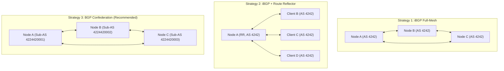

# Dynamic Routing with BIRD 2 & Network Policies

This document explains how **Easy42** configures **BIRD 2** for automated dynamic routing, BFD-based failure detection, traffic engineering, and route filtering.

---

- [Dynamic Routing with BIRD 2 \& Network Policies](#dynamic-routing-with-bird-2--network-policies)
  - [BIRD 2 Configuration Architecture](#bird-2-configuration-architecture)
    - [1. Intra-Networking Strategies \& BGP Architectures](#1-intra-networking-strategies--bgp-architectures)
      - [Strategy 1: iBGP Full-Mesh (All Nodes in Same AS)](#strategy-1-ibgp-full-mesh-all-nodes-in-same-as)
      - [Strategy 2: iBGP + BGP Route Reflector (RR)](#strategy-2-ibgp--bgp-route-reflector-rr)
      - [Strategy 3: Unique Private ASN per Node + BGP Confederation (RFC 5065) — **\[Recommended\]**](#strategy-3-unique-private-asn-per-node--bgp-confederation-rfc-5065--recommended)
      - [Architectural Note: Why BGP Exclusively? (BGP vs. Standalone IGP like Babel / OSPF)](#architectural-note-why-bgp-exclusively-bgp-vs-standalone-igp-like-babel--ospf)
    - [2. Fast Failure Detection with BFD](#2-fast-failure-detection-with-bfd)
    - [3. Route Origination \& Loopback Announcement](#3-route-origination--loopback-announcement)
    - [4. Multi-Table Kernel FIB Synchronization \& Metrics](#4-multi-table-kernel-fib-synchronization--metrics)
    - [5. Dynamic Kernel Route Import \& Static Route Broadcasting](#5-dynamic-kernel-route-import--static-route-broadcasting)
    - [6. Route Leak Protection](#6-route-leak-protection)
    - [7. FlapAlerted BGP Peering \& Alerting Integration](#7-flapalerted-bgp-peering--alerting-integration)
  - [Network Policies](#network-policies)
    - [Link Costs, Negative Costs \& Latency Steering](#link-costs-negative-costs--latency-steering)
    - [Routing Policy Modes](#routing-policy-modes)
  - [Route Origin Authorization (ROA)](#route-origin-authorization-roa)

## BIRD 2 Configuration Architecture

Easy42 generates `/etc/bird_easy42.conf` on each managed node and links it into the node's main BIRD configuration (`/etc/bird/bird.conf`) via:

```bird
include "/etc/bird_easy42.conf";
```

### 1. Intra-Networking Strategies & BGP Architectures

Easy42 allows you to implement three distinct intra-network dynamic routing architectures, catering to different network scales and redundancy goals:



#### Strategy 1: iBGP Full-Mesh (All Nodes in Same AS)

All internal nodes share the identical AS number and peer with each other in an all-to-all full mesh. No confederation or Route Reflector directives are generated.

- **Why this strategy is NOT ideal and NOT recommended**:
  - **No Path Redundancy**: Even though physical or logical links may exist in a full mesh, standard iBGP does **not** provide dynamic link-failure failover. Consider a 3-node full mesh ($A$, $B$, $C$): if link $A \leftrightarrow C$ goes down, node $A$ cannot communicate with $C$ via node $B$ as a relay, even though $A \leftrightarrow B$ and $B \leftrightarrow C$ are fully functional. This is due to the fundamental **iBGP split-horizon rule** (RFC 4271), which strictly forbids an iBGP router from advertising routes learned from one iBGP peer to another iBGP peer.

#### Strategy 2: iBGP + BGP Route Reflector (RR)

All internal nodes share the same AS number, but one or more nodes are designated as **BGP Route Reflectors** by enabling `"route_reflector": true` on the node configuration:

- **How it works**:
  - On Route Reflector nodes, Easy42 automatically appends `rr client;` to internal iBGP peer blocks that share the same ASN in `/etc/bird_easy42.conf` (external peers and internal peers with a different ASN are excluded as BIRD only permits internal neighbors to be RR clients).
  - Internal nodes and the RR typically form a hub-and-spoke (star) topology.
  - The Route Reflector relaxes the split-horizon constraint by reflecting routes learned from one client to all other clients, eliminating the need for an all-to-all full mesh.
  - In the Easy42 Web UI topology graph, Route Reflector nodes are visually highlighted with a distinct `BGP RR` / `RR Active` badge and indigo border accents, making them instantly identifiable at first glance.
- **Drawbacks & Trade-offs**:
  - **Single Point of Failure (SPOF)**: The entire network control plane depends on the Route Reflector node. If the RR becomes unreachable or crashes, client nodes cannot exchange route updates and reachability collapses.
  - While redundancy can be achieved by deploying multiple Route Reflectors, doing so introduces additional topology complexity and BGP cluster-ID coordination.

#### Strategy 3: Unique Private ASN per Node + BGP Confederation (RFC 5065) — **[Recommended]**

In this architecture, each internal node is configured with its own unique private ASN (chosen and configured by the user, commonly within `4224420000`–`4224429999` for DN42 networks), grouped under a globally configured parent Confederation AS (e.g., your public DN42 ASN `424242xxxx`):

> [!NOTE]
> **User-Configured Node ASNs**: Easy42 does **not** automatically assign ASNs to nodes. It is the user who decides and configures each node's unique ASN during node creation or editing in the Web UI, CLI, or declarative config.

```bird
define CONFED_AS = 424242xxxx;
define COMM_EXTERNAL = (CONFED_AS, 1, 1);

template bgp easy42_peer {
    confederation CONFED_AS;
    confederation member yes;  # Internal peers (sub-AS eBGP)
    default bgp_local_pref DEFAULT_LOCAL_PREF;
    ...
}

template bgp external_peer {
    confederation CONFED_AS;
    confederation member no;   # External eBGP peers
    ...
}
```

- **Why this strategy is the recommended architecture**:
  1. **Full Redundancy & Self-Healing**: Because sessions between internal member nodes operate as intra-confederation eBGP (sub-AS BGP), the iBGP split-horizon rule does **not** apply. If link $A \leftrightarrow C$ fails, traffic and route updates naturally route through node $B$ ($A \to B \to C$). As long as any physical or logical path exists between two nodes, connectivity is preserved!
  2. **External Transparency**: External peers (such as DN42 neighbors) only see announcements originating from your single public Confederation AS (`CONFED_AS`). Internal sub-AS numbers (`AS_CONFED_SEQUENCE`) are automatically stripped by BIRD before routes leave the confederation boundary.
  3. **Topology Flexibility**: No complex route reflector hierarchies or full meshes are required; nodes can be linked in arbitrary meshed, chained, or ring topologies.

- **Overcoming the Classic BIRD Confederation Path-Length Pitfall**:
  Historically, BGP confederation implementations in BIRD 2 have a well-known quirk:

  > **BIRD Confederation Path-Length Issue**:
  > When BIRD compares BGP path lengths (`AS_PATH`), it does **not** count the length of the internal confederation segment (`AS_CONFED_SEQUENCE`) towards the overall path length.
  > For example, if node $C$ receives a route from $A$ via two alternative paths: $A \to B \to C$ (2 hops) and $A \to B \to D \to C$ (3 hops) with identical base preferences, BIRD considers both paths to have equal path length and picks between them unpredictably, which can cause erratic routing and unintentional detour paths.

  **Easy42's Solution via Dynamic Link Costs**:
  Easy42 completely solves this limitation with its integrated **Link Cost** mechanism:
  - Easy42 injects custom directives into `/etc/bird_easy42.conf` to dynamically calculate `bgp_local_pref` on each link based on the link's configured cost:
    $$\text{bgp\_local\_pref} = \text{DEFAULT\_LOCAL\_PREF} (10000) - \text{cost}$$
  - Since `bgp_local_pref` is strictly preserved and propagated across all intra-network nodes (both within the same AS and across member nodes of the same BGP Confederation), BIRD deterministically and consistently chooses the lowest-cost path without relying on AS_PATH length comparison.
  - Users can fine-tune link costs (including negative costs for latency steering) to exert precise, deterministic control over internal path selection.
  - Because of these advantages, the **"each node unique ASN + BGP confederation"** pattern is the **recommended** way to architect your network in Easy42.

#### Architectural Note: Why BGP Exclusively? (BGP vs. Standalone IGP like Babel / OSPF)

Traditionally, network administrators may introduce a standalone Interior Gateway Protocol (IGP) such as **OSPF**, **IS-IS**, or **Babel** for intra-network routing, reserving BGP strictly for external border peering:

- **Potential Benefits of a Standalone IGP**:
  - **Convergence Speed**: Link-state (OSPF/IS-IS) and distance-vector (Babel) protocols are designed for rapid intra-domain reconvergence when routing topologies change.
  - **Dynamic RTT-Based Link Costs**: Protocols like Babel can continuously probe round-trip time (RTT) and dynamically adjust link metrics based on real-time latency across overlay tunnels.

- **Critical Drawbacks & Trade-offs of Introducing an IGP**:
  - **Lack of Granular Filtering & Policy Control**: BGP provides unparalleled, expressive filtering mechanisms (prefix lists, AS-path matching, policy-based transit constraints, route leak prevention, and ROA validation). IGPs fundamentally lack this level of granular policy control.
  - **Loss of BGP Attributes & Communities**: Critical routing metadata—such as BGP Standard and Large Communities (e.g., Easy42's `COMM_EXTERNAL` used to steer external peer traffic into isolated kernel tables via PBR, or DN42 region/latency tags)—cannot traverse an IGP. If routes learned from BGP are redistributed into an IGP, these attributes are stripped and lost.
  - **Redistribution Complexity & Loop Risks**: Running dual routing protocols (BGP + IGP) requires mutual two-way route redistribution, introducing operational fragility, metric conversion mismatches, and the risk of persistent routing loops.

- **The Easy42 Decision**:
  Taking all factors into consideration, **Easy42 uses BGP (BIRD 2) exclusively across the entire network—no OSPF or Babel is used at this time**. Easy42 achieves the convergence and latency-steering benefits of an IGP without sacrificing BGP's rich policy engine by:
  1. Pairing BGP with **BFD** for sub-second overlay link failure detection and failover (see [Fast Failure Detection with BFD](#2-fast-failure-detection-with-bfd)).
  2. Leveraging Easy42's deterministic **Link Cost** engine mapped to `bgp_local_pref` (including support for negative costs for latency steering; see [Link Costs, Negative Costs & Latency Steering](#link-costs-negative-costs--latency-steering)).
  3. Preserving end-to-end BGP Large Communities and path attributes for seamless multi-table Policy-Based Routing (PBR) and transit boundary enforcement.

External routes imported from external peers are tagged with the large community `COMM_EXTERNAL` so they can be steered into the external kernel routing table (`external_table`).

### 2. Fast Failure Detection with BFD

Easy42 injects a BIRD 2 BFD protocol block on every node:

```bird
protocol bfd {
    interface "*" {
        min rx interval 2000ms;
        min tx interval 2000ms;
        multiplier 5;
    };
    multihop {
        min rx interval 2000ms;
        min tx interval 2000ms;
        multiplier 5;
    };
}
```

Internal peer protocols enable `bfd yes;`, so BGP sessions are torn down when the overlay path stops responding instead of waiting for the BGP hold timer. With the generated `2000ms` intervals and multiplier `5`, detection takes roughly 10 seconds. Faster detection requires overriding the BIRD template (for example with `bird_template`).

### 3. Route Origination & Loopback Announcement

Each node has a primary stable IP (e.g., `192.168.100.1` on `lo`). To originate this route into BGP without creating a routing loop on the local host:

```bird
protocol static static_self {
    ipv4;
    route 192.168.100.1/32 reject;
    route 198.51.100.10/32 reject;   # external_ip, when configured
}

protocol static static_self_v6 {
    ipv6;
    route fd42::10/128 reject;       # ip6, when configured
    route 2001:db8::10/128 reject;   # external_ip6, when configured and different
}
```

In BIRD, a `reject` route is purely local to the routing daemon; it injects the prefix into BIRD's routing table (`master4`/`master6`) for export to peers, while the local kernel routes the local address through the loopback path. User-configured `static_routes` are emitted the same way in `static_v4`/`static_v6`, with `/32` or `/128` appended when no prefix length is given.

### 4. Multi-Table Kernel FIB Synchronization & Metrics

Learned BGP routes are exported to the Linux kernel FIB:

- **Main Routing Table** (`table 254` by default, or the node's `table`):
  ```bird
  protocol kernel kernel_v4 {
      metric 100;
      ipv4 {
          export filter {
              krt_prefsrc = SELF_IP;
              if (COMM_EXTERNAL ~ bgp_large_community) then reject;
              if (source ~ [ RTS_BGP ]) && (net ~ INTERNET) then reject;
              if source ~ [ RTS_BGP ] then accept;
              if source ~ [ RTS_STATIC ] && (net ~ PRIVATE) then accept;
              reject;
          };
          import none;
      };
      kernel table TABLE;
  }
  ```
  Setting `krt_prefsrc = SELF_IP` ensures local applications use the overlay IP when originating mesh traffic. Static `reject` routes are only installed for private prefixes, and Internet routes learned over BGP are not installed in the main table when a separate internet table is configured. `kernel_v6` mirrors this with `INTERNET6` and `PRIVATE6`.
- **External Routing Table (`external_table`)**: A pipe copies routes carrying the `COMM_EXTERNAL` large community from `master4`/`master6` into an isolated table, and a dedicated kernel protocol installs them with `krt_prefsrc` set to `external_ip`/`external_ip6` (falling back to `ip`/`ip6`). This enables Policy-Based Routing (PBR) for external peer routes.
- **Internet Routing Table (`internet_table`)**: A separate pipe/kernel pair isolates upstream transit or default routes (`INTERNET`/`INTERNET6`) into another kernel table. If `external_table` and `internet_table` are equal, external routes and Internet routes share that table. If `internet_table` differs, `COMM_EXTERNAL` routes are excluded from the internet pipe.

The metric is emitted only when configured on the node, and kernel `learn` is enabled only when the node has `routes` entries for that table.

### 5. Dynamic Kernel Route Import & Static Route Broadcasting

Nodes can dynamically redistribute existing routes into BGP:

- `routes`: Imports prefixes directly from specific Linux kernel routing tables (e.g., table 100 subnets) into BIRD using kernel protocol `learn`.
- `static_routes`: Injects static prefix announcements directly into BIRD's static protocol block for unconditional BGP advertisement.

### 6. Route Leak Protection

To prevent accidental leaks of default routes or public internet subnets into private overlays or DN42:

```bird
define PRIVATE  = [ 192.168.0.0/16+, 10.0.0.0/8+, 172.16.0.0/12+, 198.18.0.0/15+ ];
define PRIVATE6 = [ fd00::/8+ ];
define INTERNET  = [ 0.0.0.0/0, 0.0.0.0/1, 128.0.0.0/1 ];
define INTERNET6 = [ ::/0, ::/1, 8000::/1 ];

import filter {
    if net ~ INTERNET then reject;
    # policy-specific allowed/disallowed prefixes follow
    accept;
};
```

Policies with `reject_internet` enabled (the built-in `default` and `dn42` policies) reject both `INTERNET` and `INTERNET6`. Custom policies can set `/0` import and export prefix lists plus disallowed lists; entries in a disallowed list are checked before the allowed list.

### 7. FlapAlerted BGP Peering & Alerting Integration

When configured globally, Easy42 can peer with a FlapAlerted instance (`enable_fa: true` per node):

```bird
protocol bgp flapalerted {
    local LOCAL_IP as FA_ASN;
    neighbor FA_ADDR as FA_ASN port FA_PORT;
    multihop;
    ipv4 {
        add paths on;
        export all;
        import none;
        extended next hop on;
    };
    ipv6 {
        add paths on;
        export all;
        import none;
        extended next hop on;
    };
}
```

This streams all routing state to FlapAlerted without accepting inbound route injection.

---

## Network Policies

Every link endpoint in Easy42 is assigned a **Network Policy**, governing routing, firewall filters, and NAT.

| Policy        | Target Usage             | Internet Leak Protection | Forward Filter                                | Input Filter                                 | Default SNAT                                                   | ROA                     |
| :------------ | :----------------------- | :----------------------: | :-------------------------------------------- | :------------------------------------------- | :------------------------------------------------------------- | :---------------------- |
| **`default`** | Internal mesh nodes      | Yes (`reject_internet`)  | Disabled                                      | Disabled                                     | Disabled                                                       | None                    |
| **`dn42`**    | External / DN42 peers    | Yes (`reject_internet`)  | Enabled against allowed/disallowed DN42 CIDRs | Enabled; TCP 179 always, UDP 53, ICMP/ICMPv6 | `external_ip`, when the source is outside the allowed CIDR set | Burble IPv4 + IPv6 URLs |
| **`none`**    | Unrestricted tunnels     |            No            | Disabled                                      | Disabled                                     | Disabled                                                       | None                    |
| _Custom_      | Custom peering / transit |       Configurable       | Configurable CIDRs                            | Configurable ports                           | Configurable                                                   | Custom URLs             |

Policy defaults are resolved at compile time:

- An endpoint without an explicit policy uses `dn42` when the **remote** endpoint is external, and `default` otherwise.
- Built-in policies are always present and cannot be edited. Custom policies with the same ID take precedence over built-ins.
- The default DN42 prefix list comes from global `network_settings.prefixes` when set; otherwise it uses the standard DN42/ChaosVPN/Freifunk/NeoNetwork ranges. `disallowed_dn42_networks` / `disallowed_dn42_cidrs` add exclusions.
- If neither `external_ip`/`external_ip6` is configured for a SNAT target, no corresponding SNAT rule is emitted for that family.

### Link Costs, Negative Costs & Latency Steering

Each policy defines a base `cost` (default: 100), which can be overridden by `cost` on an individual link endpoint:

- **In confederation mode only**, BIRD adjusts `bgp_local_pref` on import. Without a confederation ASN, the cost is still stored and displayed but does not alter `bgp_local_pref`.
- Positive cost: `bgp_local_pref = DEFAULT_LOCAL_PREF(10000) − cost` (floored at 1).
- **Negative link costs** (e.g. `-50`) increase preference above 10000: `bgp_local_pref = 10000 + |cost|`, clamped to the 32-bit maximum. This allows explicitly preferring high-bandwidth or primary transit paths.
- An endpoint `cost` of `0` means "inherit the policy cost"; it is not a literal zero cost.

### Routing Policy Modes

Each policy or link endpoint can enforce a BGP routing policy. Aliases are normalized by the configuration layer:

| Mode             | Aliases                                          | Import behavior                                    | Export behavior                                                                        |
| :--------------- | :----------------------------------------------- | :------------------------------------------------- | :------------------------------------------------------------------------------------- |
| `full` (default) | `transit`, `mesh`, empty                         | Accepts valid routes after leak/ROA/filter checks. | Exports all valid routes after leak/filter checks.                                     |
| `stub`           | `originate_only`, `local_only`, `transit_client` | Accepts routes from the peer normally.             | Exports only `RTS_STATIC`, `RTS_DEVICE`, and `RTS_INHERIT` routes (local origination). |
| `receive_only`   | `import_only`                                    | Accepts routes from the peer normally.             | Rejects all exports.                                                                   |
| `advertise_only` | `export_only`                                    | Rejects all imports.                               | Exports local-originated routes (`RTS_STATIC`, `RTS_DEVICE`, `RTS_INHERIT`).           |

Unrecognized or empty values normalize to `full`.

---

## Route Origin Authorization (ROA)

Route Origin Authorization verifies that the announcing AS is authorized to originate a given IP prefix. Easy42 includes an automatic ROA caching engine.

- Policies can define separate IPv4 (`roa4`) and IPv6 (`roa6`) ROA URLs. The built-in `dn42` policy points at `https://dn42.burble.com/roa/dn42_roa_bird2_4.conf` and `..._6.conf`.
- The controller downloads and caches each file locally in the data directory. A refresh endpoint (`POST /api/network-policies/{id}/refresh-roa`) forces an update, and `POST /api/roa/refresh` refreshes all policies.
- During node sync, cached tables are deployed to `/etc/easy42_<policy>_roa4.conf` and `/etc/easy42_<policy>_roa6.conf` (for example `/etc/easy42_dn42_roa4.conf`).
- BIRD checks incoming routes using native static ROA tables. The generated names follow `<policy>_roa4` / `<policy>_roa6` for tables, `<policy>_roa4_static` / `<policy>_roa6_static` for protocols, and `<policy>_roa_check` for the function:

```bird
roa4 table dn42_roa4;
protocol static dn42_roa4_static {
    roa4 { table dn42_roa4; };
    include "/etc/easy42_dn42_roa4.conf";
}

roa6 table dn42_roa6;
protocol static dn42_roa6_static {
    roa6 { table dn42_roa6; };
    include "/etc/easy42_dn42_roa6.conf";
}

function dn42_roa_check() {
    if net.type = NET_IP4 then {
        if roa_check(dn42_roa4, net, bgp_path.last) = ROA_VALID then return true;
        if roa_check(dn42_roa4, net, bgp_path.last) = ROA_UNKNOWN then return true; # Non-strict mode
        return false; # ROA_INVALID
    } else {
        if roa_check(dn42_roa6, net, bgp_path.last) = ROA_VALID then return true;
        if roa_check(dn42_roa6, net, bgp_path.last) = ROA_UNKNOWN then return true; # Non-strict mode
        return false; # ROA_INVALID
    }
}
```

With `roa_strict: true`, `ROA_UNKNOWN` is rejected as well, leaving only `ROA_VALID`. If a family has no ROA URL, that family's check returns true (no restriction). Custom policies can reuse the same mechanism with their own URLs.
